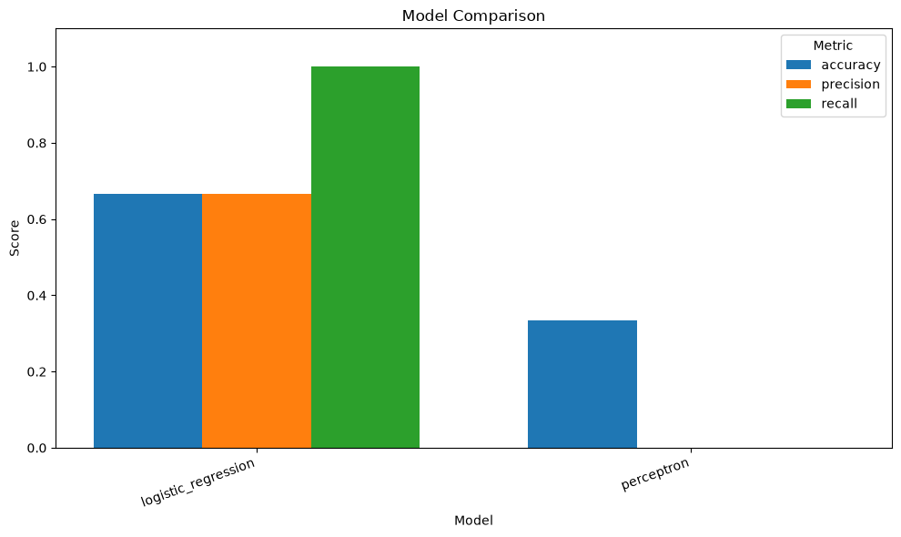
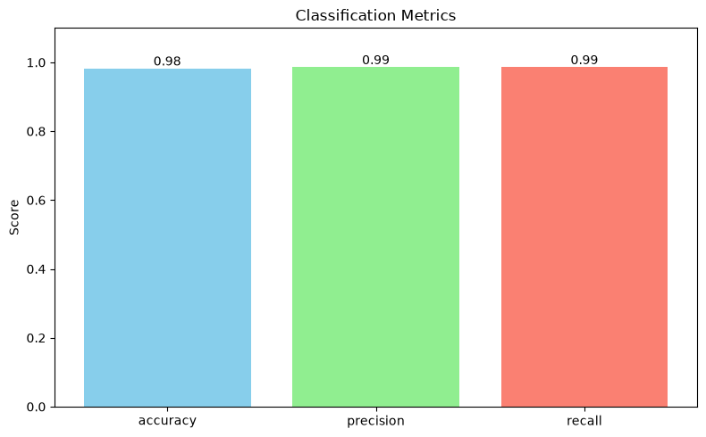
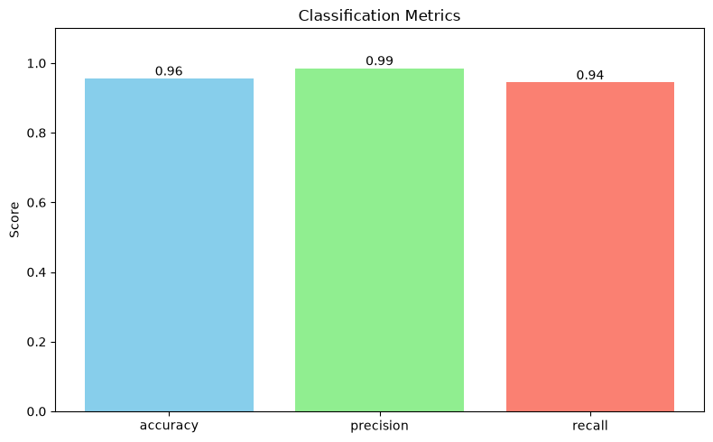
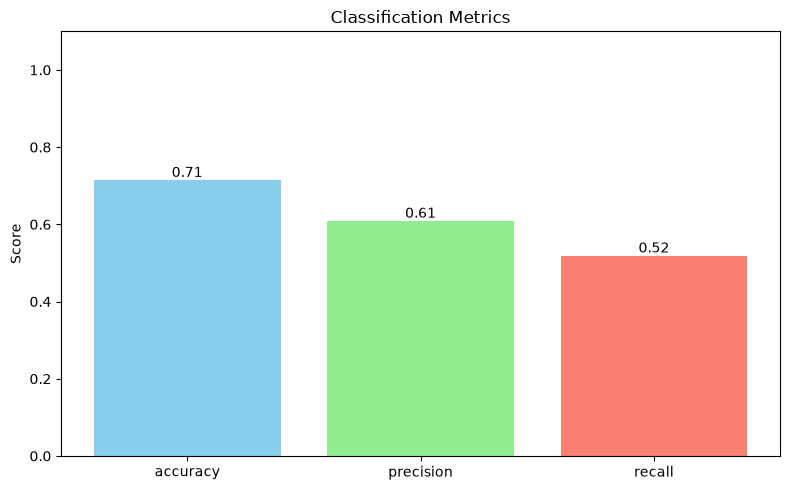
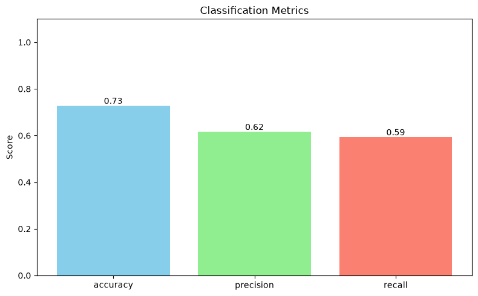

# Контрольный прогон: метрики и разбор датасетов (`example_metrics_run`)

Пример воспроизводимого прогона пайплайна на обоих датасетах и обеих
моделях. Числа получены на hold-out тестовой выборке; они не являются
порогами и не проверяются в unit-тестах.

## Что запускалось

Полный прогон «2 датасета × 2 модели»:

```bash
# Windows
run_windows.bat

# Linux / macOS
./run_linux_mac.sh

# напрямую (из dz9/)
PYTHONPATH=src python -m model_quality_lab \
  --all-datasets --all-models \
  --train --predict --metrics --visualize
```

Для каждого датасета данные один раз делятся на train/test со
стратификацией, затем на train обучаются обе модели, а метрики считаются на
общем test. Split не пересекается, тест не участвует в обучении.

## Окружение и конфигурация

| Параметр | Значение |
|---|---|
| Дата прогона | 2026-11-04 |
| Python | 3.13.11 |
| scikit-learn | 1.9.1 |
| numpy | 2.5.4 |
| matplotlib | 3.11.2 |
| `RANDOM_STATE` | `42` |
| `TEST_SIZE` | `0.2` |
| `MODEL_MAX_ITER` | `5000` |
| Модели | `logistic_regression`, `perceptron` |
| Датасеты | `breast_cancer` (569), `pima_indians` (768) |

Обе модели обучаются внутри `Pipeline(StandardScaler, model)`, поэтому
признаки на разных шкалах не искажают сравнение.

## Разбор датасетов

| Датасет | Строк | Признаков | Класс `0` | Класс `1` | Test (20%) | Train (80%) |
|---|---|---|---|---|---|---|
| `breast_cancer` | 569 | 30 | 212 | 357 | 114 | 455 |
| `pima_indians` | 768 | 8 | 500 | 268 | 154 | 614 |

### `breast_cancer`

- Встроен в scikit-learn, скачивание не требуется.
- 30 числовых признаков (размеры ядра, текстура, гладкость и т. д.),
  пропусков нет.
- Классы: `0` — злокачественная опухоль (212), `1` — доброкачественная
  (357). Умеренный дисбаланс, стратификация сохраняет пропорции.
- Признаки информативны, классы хорошо разделимы линейной границей —
  поэтому обе линейные модели показывают высокое качество.

### `pima_indians`

- 768 строк, 8 признаков: число беременностей, глюкоза, давление, толщина
  кожи, инсулин, ИМТ, диабетическая наследственность, возраст.
- Классы: `0` — нет диабета (500), `1` — диабет (268). Дисбаланс заметнее,
  чем у breast cancer.
- **Пропуски закодированы нулями:** глюкоза — 5, давление — 35, толщина
  кожи — 227, инсулин — 374, ИМТ — 11. Физиологически нулевыми эти
  показатели быть не могут; импутация в объём проекта не входит, поэтому
  шум в признаках снижает качество.
- Признаки на разных шкалах (глюкоза ~100 против наследственности ~0.5) —
  без стандартизации линейные модели работают плохо.

## Результаты

| Датасет | Модель | Accuracy | Precision | Recall |
|---|---|---|---|---|
| `breast_cancer` | `logistic_regression` | 0.982 | 0.986 | 0.986 |
| `breast_cancer` | `perceptron` | 0.956 | 0.986 | 0.944 |
| `pima_indians` | `logistic_regression` | 0.714 | 0.609 | 0.519 |
| `pima_indians` | `perceptron` | 0.727 | 0.615 | 0.593 |

## Матрицы ошибок

Матрица ошибок — это те же числа, из которых считаются accuracy, precision и
recall, но в явном виде: сколько объектов каждого класса модель угадала и
сколько перепутала. Пайплайн печатает её в консоль при флагах `--metrics` или
`--visualize` (блок `Confusion matrix (test set, ...)`).

| Датасет | Модель | TP | TN | FP | FN | Всего |
|---|---|---|---|---|---|---|
| `breast_cancer` | `logistic_regression` | 71 | 41 | 1 | 1 | 114 |
| `breast_cancer` | `perceptron` | 68 | 41 | 1 | 4 | 114 |
| `pima_indians` | `logistic_regression` | 28 | 82 | 18 | 26 | 154 |
| `pima_indians` | `perceptron` | 32 | 80 | 20 | 22 | 154 |

- **TP** — верно найденный класс `1`; **TN** — верно распознанный класс `0`.
- **FP** — ложная тревога (предсказан `1`, на самом деле `0`).
- **FN** — пропуск (предсказан `0`, на самом деле `1`).
- Сумма `TP + TN + FP + FN` равна размеру тестовой выборки.

Из матриц видно, откуда берутся метрики. На `breast_cancer` у логистической
регрессии всего 2 ошибки на 114 объектов (`FP = 1`, `FN = 1`), у перцептрона
— 5 ошибок, почти все за счёт пропусков (`FN = 4`). На `pima_indians` картина
другая: лучшая модель пропускает 22–26 больных из 54 и даёт 18–20 ложных
тревог — именно поэтому recall здесь около 0.5–0.6, а не 0.9.

## Интерпретация

**`breast_cancer`.** Обе модели близки к идеалу: логистическая регрессия
немного лучше по accuracy и recall (0.982/0.986 против 0.956/0.944).
Precision у моделей одинаковый (0.986) — обе почти не дают ложных
срабатываний. Разница в recall означает, что перцептрон пропускает чуть
больше положительных объектов.

**`pima_indians`.** Задача заметно сложнее: accuracy ~0.71–0.73, recall
0.52–0.59. Это значит, что модель находит примерно половину пациентов с
диабетом, а вторая половина остаётся пропущенной. Precision ~0.61: около
39 % положительных предсказаний — ложные. На этом датасете перцептрон
немного лучше по всем трём метрикам, но разница находится в пределах
статистического шума одного split.

**Почему масштабирование важно.** Если убрать `StandardScaler`, точность
перцептрона на `breast_cancer` падает примерно до 0.56: признаки с большим
диапазоном начинают доминировать, и линейная граница получается плохой.
Поэтому scaler входит в `Pipeline`, а не применяется отдельно.

**Практический вывод.** На «чистых» и информативных данных обе модели
работают хорошо; на зашумлённых данных с пропусками качество ограничено
самим датасетом, а не выбором между двумя линейными моделями. Для `pima`
разумно смотреть на recall, если цель — не пропустить заболевание, и на
precision, если важна цена ложной тревоги.

## Ограничения прогона

- Один hold-out split, без кросс-валидации: небольшие различия между
  моделями могут быть случайными.
- Гиперпараметры не подбирались.
- Пропуски в `pima_indians` не импутируются, выбросы не обрабатываются.
- Вероятности не калибруются, ROC-AUC / F1 не считаются (вне объёма ТЗ).
- Числа зависят от версий scikit-learn/numpy; при обновлении возможны
  небольшие расхождения. Версии контрольного прогона зафиксированы в
  `requirements.txt` и `uv.lock`.

## Артефакты последнего прогона

Все графики ниже сгенерированы последним полным прогоном
(`--all-datasets --all-models --visualize`).

### Сравнительный график

[](output/metrics_comparison.png)

### `breast_cancer`

| Модель | График |
|---|---|
| `logistic_regression` | [](output/metrics_breast_cancer_logistic_regression.png) |
| `perceptron` | [](output/metrics_breast_cancer_perceptron.png) |

### `pima_indians`

| Модель | График |
|---|---|
| `logistic_regression` | [](output/metrics_pima_indians_logistic_regression.png) |
| `perceptron` | [](output/metrics_pima_indians_perceptron.png) |

Сами файлы лежат в `output/`; модели (`.pkl`) в git не хранятся, а графики
последнего прогона закоммичены, чтобы ссылки в документации работали.

## Как воспроизвести

1. Установить зависимости: `uv sync` (берёт версии из `uv.lock`) или
   `uv pip install -r requirements.txt` (те же точные версии).
2. Выполнить команду из раздела «Что запускалось».
3. Сравнить таблицу с выводом `Comparison summary` в консоли.

Окружение контрольного прогона: Python 3.13.11, scikit-learn 1.9.1,
numpy 2.5.4, matplotlib 3.11.2.
