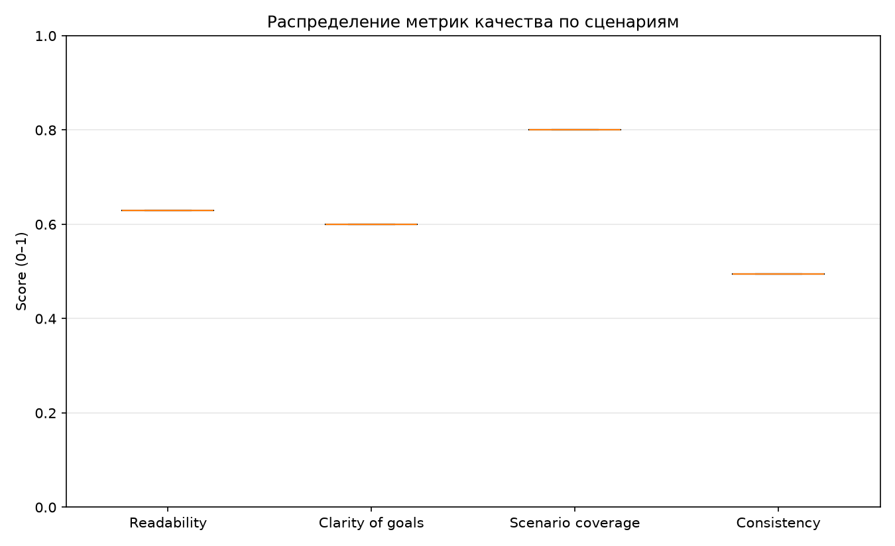
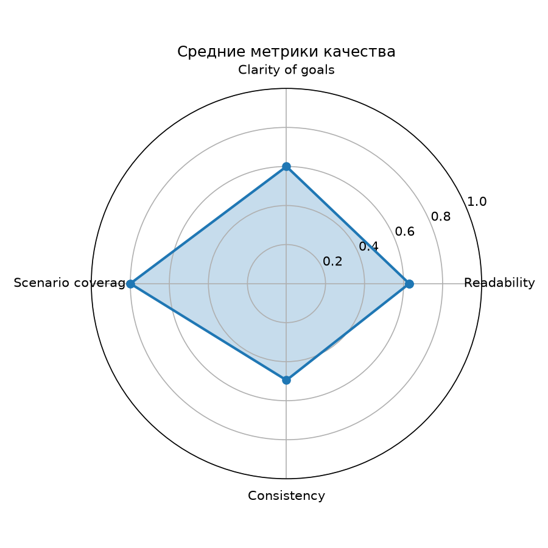
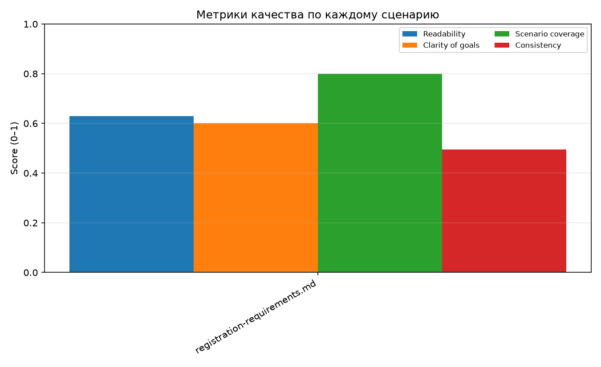

# Демонстрация: живой прогон

Пример полного пайплайна на общей модели `qwen2.5:7b-instruct` из `ohw-ollama`.
Исходники примера лежат в [`examples/live-run/`](../examples/live-run/).

## Команда

Внутри сети `ohw_net`:

```bash
python -m src.workflow \
  --input-dir input \
  --output-dir output/live \
  --count 4 \
  --runs 2 \
  --temperature 0.2
```

Или локально:

```bash
uv run python -m src.workflow \
  --input-dir input --output-dir output/live \
  --count 4 --runs 2 --temperature 0.2
```

## Результат

```text
фазы: generate -> assess -> visualize -> report
генерация: input -> output/live/scenarios
  (тип=testcases, кейсов=4, повторов=2, модель=qwen2.5:7b-instruct)
  registration-requirements.md: overall=0.646 (попыток=1)
оценка: overall=0.646 (1/1 сценариев успешны)
визуализация: charts/metrics_boxplot.png, charts/per_scenario_scores.png, charts/radar_chart.png
отчёт: output/live/report.md
данные: output/live/quality-metrics.json
```

## Метрики

| Метрика | Значение | Доля |
|---|---:|---:|
| Readability | 0.629 | 62.9% |
| Clarity of goals | 0.600 | 60.0% |
| Scenario coverage | 0.800 | 80.0% |
| Consistency | 0.495 | 49.5% |
| **Overall** | **0.646** | **64.6%** |

- Покрытие 0.8: из `BR-1…BR-5` в результате упомянуты `BR-1, BR-2, BR-3, BR-5`;
  `BR-4` (совпадение паролей) не попал в тест-кейсы.
- Консистентность 0.495: две генерации при `--runs 2` дали примерно половину
  общих слов. Это уже измерение, а не эвристика `--runs 1`.
- Все 4 кейса валидны, потребовалась 1 попытка.

## Сгенерированные кейсы

| ID | Тип | Заголовок | Требование |
|---|---|---|---|
| TC-01 | positive | Открытие формы регистрации | BR-1 |
| TC-02 | positive | Успешная регистрация с корректными данными | BR-5 |
| TC-03 | negative | Некорректный email при регистрации | BR-2 |
| TC-04 | negative | Пароль не соответствует требованиям при регистрации | BR-3 |

## Графики







## Отчёт

- [`report.md`](../examples/live-run/report.md)
- [`quality-metrics.json`](../examples/live-run/quality-metrics.json)
- [`scenarios/registration-requirements.md`](../examples/live-run/scenarios/registration-requirements.md)

## E2E на требованиях из SDD

Отдельный integration-тест использует в качестве источника
`tests/e2e/input/sdd-requirements.md`, выделенный из [`SDD.md`](../SDD.md).
Этим проверяется генерация на реальном документе проекта:

```bash
RUN_OLLAMA_INTEGRATION=1 uv run pytest -m integration
```

Результат прогона: `1 passed, 53 deselected in 147.99s`. Средний `overall`
на плотных требованиях из SDD — `0.399`: текст требований длинный и
формальный, поэтому читаемость ниже, чем на коротком примере регистрации.
Структурно пайплайн отработал полностью: сценарий сгенерирован, метрики
посчитаны, графики и отчёт созданы. Это ожидаемое поведение, а не сбой.

В Docker:

```bash
docker run --rm --network ohw_net -v "$PWD:/repo" -w /repo \
  -e OLLAMA_BASE_URL=http://ohw-ollama:11434 \
  -e RUN_OLLAMA_INTEGRATION=1 \
  ghcr.io/astral-sh/uv:python3.13-bookworm-slim uv run pytest -m integration
```

## Как воспроизвести

1. Запустить общий стенд: `./infra/up.sh graduation-project` (или `.\run.ps1`).
2. Убедиться, что модель доступна: `docker exec ohw-ollama ollama list`.
3. Выполнить команду из раздела «Команда».
4. Открыть `output/live/report.md` и `output/live/charts/*.png`.
