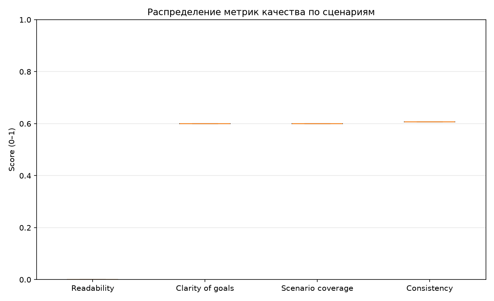
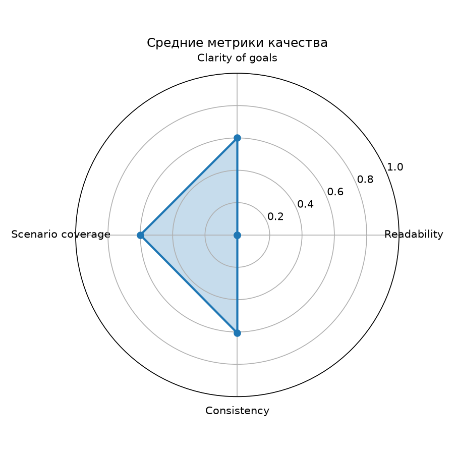
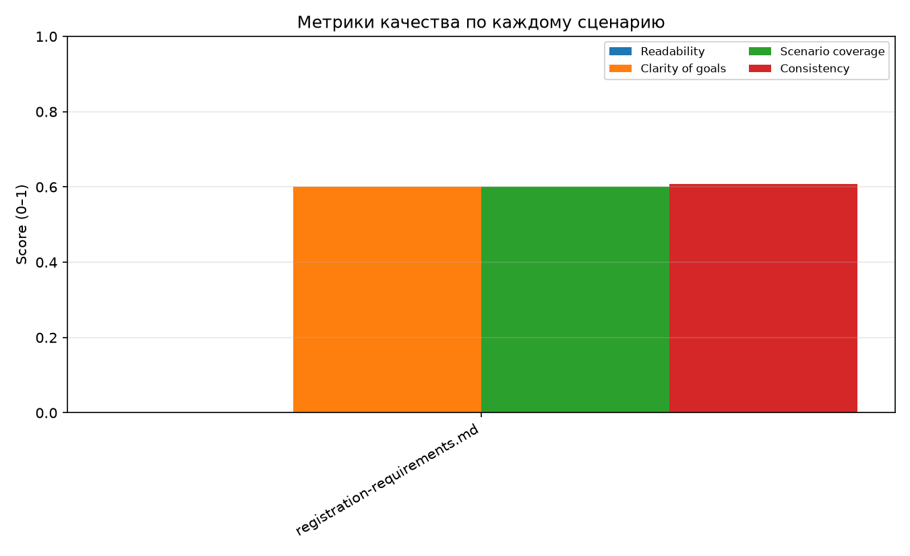

# Демонстрация: живой прогон

Пример полного пайплайна на общей модели `qwen2.5:7b-instruct` из `ohw-ollama`.

Зафиксированный результат финального прогона лежит в [`output/`](../output/):
`generation.json`, `quality-metrics.json`, `report.md`, `scenarios/` и `charts/`.
Он получен теми же параметрами, но с `--output-dir output`.

В `examples/live-run/` остался более ранний пример. Его снимок записан до
введения `pipeline_version` и `quality_weights` и читается как legacy. Он не
является текущим демо и перезаписывать его не нужно.

## Команда

Локально:

```bash
uv run python -m src.workflow \
  --input-dir input --output-dir output/live \
  --count 4 --runs 2 --temperature 0.2
```

Так можно воспроизвести прогон, не задевая зафиксированные артефакты в `output/`.
Финальный прогон, результат которогоocommitted в репозиторий, использовал
`--output-dir output`.

## Результат финального прогона

```text
фазы: generate -> assess -> visualize -> report
генерация: input -> output/scenarios
  (тип=testcases, кейсов=4, повторов=2, модель=qwen2.5:7b-instruct)
веса overall: readability=0.25, clarity_goals=0.25, scenario_coverage=0.30, consistency=0.20
  registration-requirements.md: overall=0.451 (попыток=1)
оценка: overall=0.451 (0/1 сценариев успешны)
визуализация: charts/metrics_boxplot.png, charts/per_scenario_scores.png, charts/radar_chart.png
отчёт: output/report.md
данные: output/quality-metrics.json
```

Пайплайн завершился с кодом `0`: все стадии отработали, файлы созданы.
`overall = 0.451` ниже порога `0.5`, поэтому сценарий помечен как
«требует доработки». Это честный результат метрики, а не сбой генерации.

## Метрики

| Метрика | Значение | Доля |
|---|---:|---:|
| Readability | 0.000 | 0.0% |
| Clarity of goals | 0.600 | 60.0% |
| Scenario coverage | 0.600 | 60.0% |
| Consistency | 0.607 | 60.7% |
| **Overall** | **0.451** | **45.1%** |

- Readability `0.000`: средняя длина предложения в этой генерации сильно
  отклоняется от оптимума 17 слов. Метрика честно показывает слабое место текста.
- Coverage `0.600`: из `BR-1…BR-5` в результате упомянуты `BR-2`, `BR-3` и
  `BR-5`; `BR-1` и `BR-4` не попали в тест-кейсы.
- Consistency `0.607`: две генерации при `--runs 2` дали умеренное совпадение
  множеств слов. Это измерение, а не эвристика `--runs 1`.
- Все 4 кейса валидны, потребовалась 1 попытка.

## Как поменять веса

Веса `overall` задаются на фазе `generate` флагом:

```bash
uv run python -m src.workflow \
  --input-dir input --output-dir output/live \
  --count 4 --runs 2 --temperature 0.2 \
  --quality-weights readability=0.4,clarity_goals=0.2,scenario_coverage=0.2,consistency=0.2
```

Или переменной окружения `GRADUATION_QUALITY_WEIGHTS` в том же формате. Флаг
важнее env, env важнее значений по умолчанию. Фактические веса сохраняются в
`generation.json` и `quality-metrics.json`, а в `report.md` появляется строка:

```text
| Веса overall | readability=0.40, clarity_goals=0.20, scenario_coverage=0.20, consistency=0.20 |
```

`--assess` не принимает веса из флага: он пересчитывает метрики по снимку,
поэтому результат воспроизводим. Чтобы пересчитать старый прогон с другой
политикой, измените `quality_weights` в `generation.json` и запустите
`--assess` заново.

С теми же метриками, но с весами `0.4 / 0.2 / 0.2 / 0.2` получится:

```text
0.4×0.000 + 0.2×0.600 + 0.2×0.600 + 0.2×0.607 = 0.361
```

То есть смена политики весов меняет `overall`, но не меняет сами метрики.
Неверная сумма, отрицательное значение или неизвестная метрика дают код `2`
и понятное сообщение. В UI веса задаются в сайдбаре.

## Сгенерированные кейсы

| ID | Тип | Заголовок | Требование |
|---|---|---|---|
| TC-01 | positive | Успешная регистрация с корректными данными | BR-5 |
| TC-02 | positive | Успешная регистрация с минимальными требованиями | BR-5 |
| TC-03 | negative | Ошибка валидации email | BR-2 |
| TC-04 | negative | Ошибка валидации пароля | BR-3 |

## Графики







## Отчёт

- [`report.md`](../output/report.md)
- [`quality-metrics.json`](../output/quality-metrics.json)
- [`generation.json`](../output/generation.json)
- [`scenarios/registration-requirements.md`](../output/scenarios/registration-requirements.md)

## Проверка повреждённых артефактов

Оба JSON-файла валидируются по pydantic-схемам до чтения. На копии снимка
удалите `filename` из сценария — `--assess` не упадёт с traceback:

```text
$ uv run python -m src.workflow --assess --output-dir /tmp/copy-of-output
фазы: assess
ошибка входа: generation.json: неверный формат артефакта —
scenarios[0].filename: обязательное поле отсутствует
$ echo $?
2
```

Так же обрабатываются битый JSON (с номером строки и колонки), неверный тип
поля и файл не в UTF-8. Неизвестные поля игнорируются, а legacy-снимки без
`pipeline_version` и `quality_weights` читаются как раньше.

## E2E на требованиях из SDD

Отдельный integration-тест использует в качестве источника
`tests/e2e/input/sdd-requirements.md`, выделенный из [`SDD.md`](../SDD.md).
Этим проверяется генерация на реальном документе проекта:

```bash
RUN_OLLAMA_INTEGRATION=1 uv run pytest -m integration
```

Результат прогона на живом стенде с `qwen2.5:7b-instruct`:
`1 passed, 223 deselected in 166.56s` (последняя проверка в контейнере на GPU).
Ранее на хосте был зафиксирован результат `1 passed, 208 deselected in 13.86s`.
Средний `overall` на плотных требованиях из SDD — `0.382`,
`consistency = 0.618` при `runs = 2`. Текст требований длинный и формальный,
поэтому читаемость ниже, чем на коротком примере регистрации. Структурно
пайплайн отработал полностью: сценарий сгенерирован, метрики посчитаны, графики
и отчёт созданы. Это ожидаемое поведение, а не сбой.

Прогон выполнялся на NVIDIA RTX 2070 SUPER: пик VRAM — около 5.3 ГБ из 8 ГБ,
доступная RAM хоста в момент инференса — около 2 ГБ. Модель уже была в volume
`ohw_ollama_models`, повторной загрузки не потребовалось.

В Docker:

```bash
docker run --rm --network ohw_net -v "$PWD:/repo" -w /repo \
  -e OLLAMA_BASE_URL=http://ohw-ollama:11434 \
  -e RUN_OLLAMA_INTEGRATION=1 \
  ghcr.io/astral-sh/uv:python3.13-bookworm-slim uv run pytest -m integration
```

## Как воспроизвести

1. Запустить общий стенд:
   - Windows CPU: `.\run-cpu.ps1`
   - Windows NVIDIA: `.\run-gpu.ps1`
   - Linux/macOS CPU: `./run.sh`
   - базовый вариант: `.\run.ps1` или `.\run.ps1 -Gpu`
2. Убедиться, что модель доступна: `docker exec ohw-ollama ollama list`.
3. Выполнить команду из раздела «Команда».
4. Открыть `output/live/report.md` и `output/live/charts/*.png`.
   Зафиксированные артефакты находятся в `output/`.
