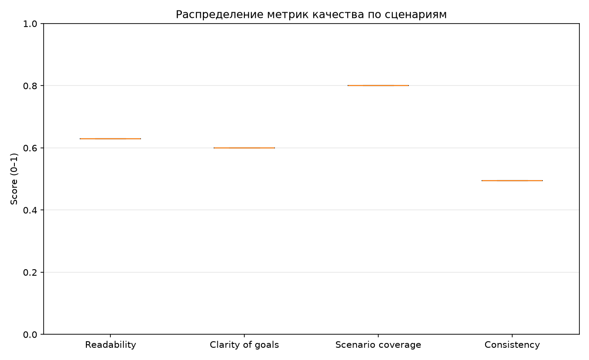
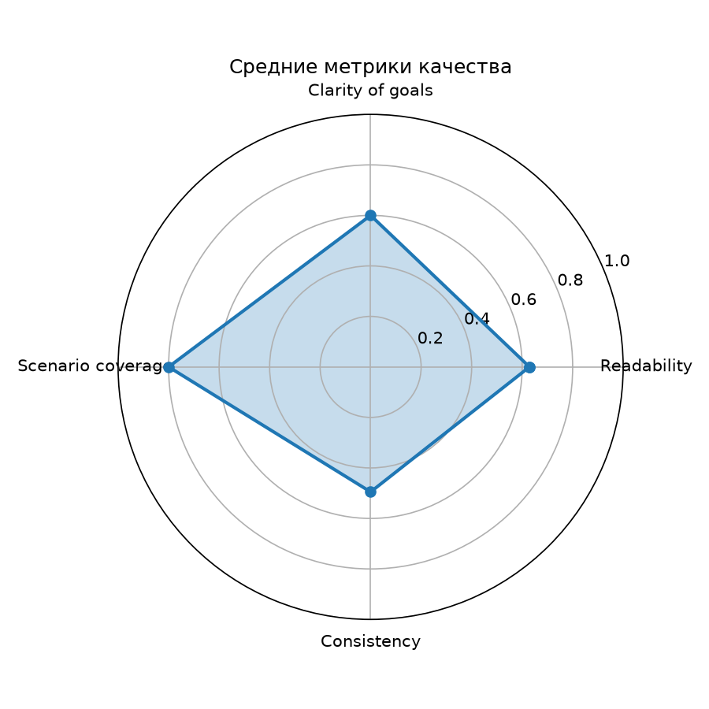
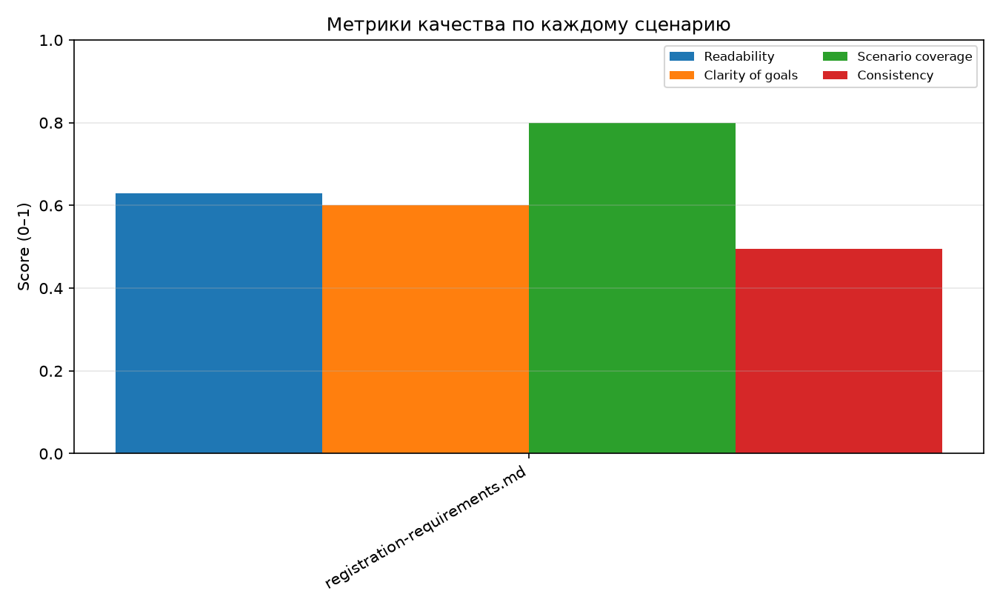

# Демонстрация: живой прогон

Пример полного пайплайна на общей модели `qwen2.5:7b-instruct` из `ohw-ollama`.
Исходники примера лежат в [`examples/live-run/`](../examples/live-run/).

Снимок в `examples/live-run/` записан до введения `pipeline_version` и
`quality_weights`; валидация принимает его как legacy. Новые прогоны добавляют
обе ключевые записи в `generation.json` и `quality-metrics.json`. Демо-файлы
перезаписывать не нужно: команды ниже пишут в `output/live/`.

## Команда

Внутри сети `ohw_net`:

```bash
python -m src.workflow \
  --input-dir input \
  --output-dir output/live \
  --count 4 \
  --runs 2 \
  --temperature 0.2
```

Или локально:

```bash
uv run python -m src.workflow \
  --input-dir input --output-dir output/live \
  --count 4 --runs 2 --temperature 0.2
```

## Результат

```text
фазы: generate -> assess -> visualize -> report
генерация: input -> output/live/scenarios
  (тип=testcases, кейсов=4, повторов=2, модель=qwen2.5:7b-instruct)
веса overall: readability=0.25, clarity_goals=0.25, scenario_coverage=0.30, consistency=0.20
  registration-requirements.md: overall=0.646 (попыток=1)
оценка: overall=0.646 (1/1 сценариев успешны)
визуализация: charts/metrics_boxplot.png, charts/per_scenario_scores.png, charts/radar_chart.png
отчёт: output/live/report.md
данные: output/live/quality-metrics.json
```

## Метрики

| Метрика | Значение | Доля |
|---|---:|---:|
| Readability | 0.629 | 62.9% |
| Clarity of goals | 0.600 | 60.0% |
| Scenario coverage | 0.800 | 80.0% |
| Consistency | 0.495 | 49.5% |
| **Overall** | **0.646** | **64.6%** |

- Покрытие 0.8: из `BR-1…BR-5` в результате упомянуты `BR-1, BR-2, BR-3, BR-5`;
  `BR-4` (совпадение паролей) не попал в тест-кейсы.
- Консистентность 0.495: две генерации при `--runs 2` дали примерно половину
  общих слов. Это уже измерение, а не эвристика `--runs 1`.
- Все 4 кейса валидны, потребовалась 1 попытка.

## Как поменять веса

Веса `overall` задаются на фазе `generate` флагом:

```bash
uv run python -m src.workflow \
  --input-dir input --output-dir output/live \
  --count 4 --runs 2 --temperature 0.2 \
  --quality-weights readability=0.4,clarity_goals=0.2,scenario_coverage=0.2,consistency=0.2
```

Или переменной окружения `GRADUATION_QUALITY_WEIGHTS` в том же формате. Флаг
важнее env, env важнее значений по умолчанию. Фактические веса сохраняются в
`generation.json` и `quality-metrics.json`, а в `report.md` появляется строка:

```text
| Веса overall | readability=0.40, clarity_goals=0.20, scenario_coverage=0.20, consistency=0.20 |
```

`--assess` не принимает веса из флага: он пересчитывает метрики по снимку,
поэтому результат воспроизводим. Чтобы пересчитать старый прогон с другой
политикой, измените `quality_weights` в `generation.json` и запустите
`--assess` заново.

Тот же прогон с весами `0.4 / 0.2 / 0.2 / 0.2` даёт `overall = 0.631` вместо
`0.646` при тех же метриках:

```text
0.4×0.629 + 0.2×0.600 + 0.2×0.800 + 0.2×0.495 = 0.631
```

Неверная сумма, отрицательное значение или неизвестная метрика дают код `2`
и понятное сообщение. UI использует веса по умолчанию.

## Сгенерированные кейсы

| ID | Тип | Заголовок | Требование |
|---|---|---|---|
| TC-01 | positive | Открытие формы регистрации | BR-1 |
| TC-02 | positive | Успешная регистрация с корректными данными | BR-5 |
| TC-03 | negative | Некорректный email при регистрации | BR-2 |
| TC-04 | negative | Пароль не соответствует требованиям при регистрации | BR-3 |

## Графики







## Отчёт

- [`report.md`](../examples/live-run/report.md)
- [`quality-metrics.json`](../examples/live-run/quality-metrics.json)
- [`scenarios/registration-requirements.md`](../examples/live-run/scenarios/registration-requirements.md)

## Проверка повреждённых артефактов

Оба JSON-файла валидируются по pydantic-схемам до чтения. Если удалить
`filename` из сценария в `generation.json`, `--assess` не падает с traceback:

```text
$ uv run python -m src.workflow --assess --output-dir output/live
фазы: assess
ошибка входа: generation.json: неверный формат артефакта —
scenarios[0].filename: обязательное поле отсутствует
$ echo $?
2
```

Так же обрабатываются битый JSON (с номером строки и колонки), неверный тип
поля и файл не в UTF-8. Неизвестные поля игнорируются, а legacy-снимки без
`pipeline_version` и `quality_weights` читаются как раньше.

## E2E на требованиях из SDD

Отдельный integration-тест использует в качестве источника
`tests/e2e/input/sdd-requirements.md`, выделенный из [`SDD.md`](../SDD.md).
Этим проверяется генерация на реальном документе проекта:

```bash
RUN_OLLAMA_INTEGRATION=1 uv run pytest -m integration
```

Результат прогона на живом стенде с `qwen2.5:7b-instruct`:
`1 passed, 208 deselected in 13.86s`. Средний `overall` на плотных требованиях
из SDD — `0.382`, `consistency = 0.618` при `runs = 2`. Текст требований
длинный и формальный, поэтому читаемость ниже, чем на коротком примере
регистрации. Структурно пайплайн отработал полностью: сценарий сгенерирован,
метрики посчитаны, графики и отчёт созданы. Это ожидаемое поведение, а не сбой.

Прогон выполнялся на NVIDIA RTX 2070 SUPER через `.\run.ps1 -Gpu`: пик VRAM —
около 5.3 ГБ из 8 ГБ, доступная RAM хоста в момент инференса — около 2 ГБ.
Модель уже была в volume `ohw_ollama_models`, повторной загрузки не потребовалось.

В Docker:

```bash
docker run --rm --network ohw_net -v "$PWD:/repo" -w /repo \
  -e OLLAMA_BASE_URL=http://ohw-ollama:11434 \
  -e RUN_OLLAMA_INTEGRATION=1 \
  ghcr.io/astral-sh/uv:python3.13-bookworm-slim uv run pytest -m integration
```

## Как воспроизвести

1. Запустить общий стенд: `./infra/up.sh graduation-project` (или `.\run.ps1`;
   для NVIDIA — `.\run.ps1 -Gpu`).
2. Убедиться, что модель доступна: `docker exec ohw-ollama ollama list`.
3. Выполнить команду из раздела «Команда».
4. Открыть `output/live/report.md` и `output/live/charts/*.png`.
