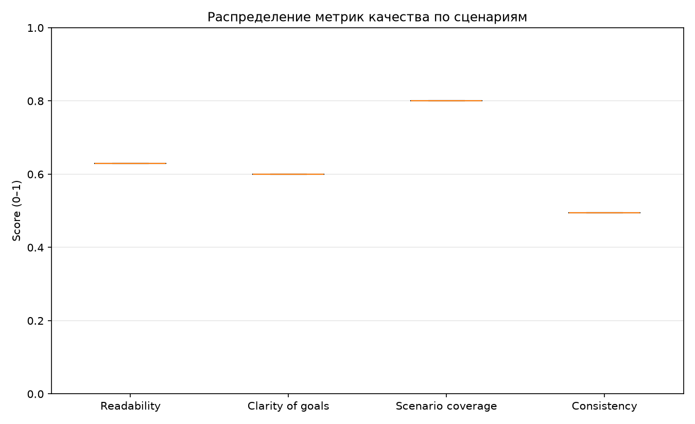
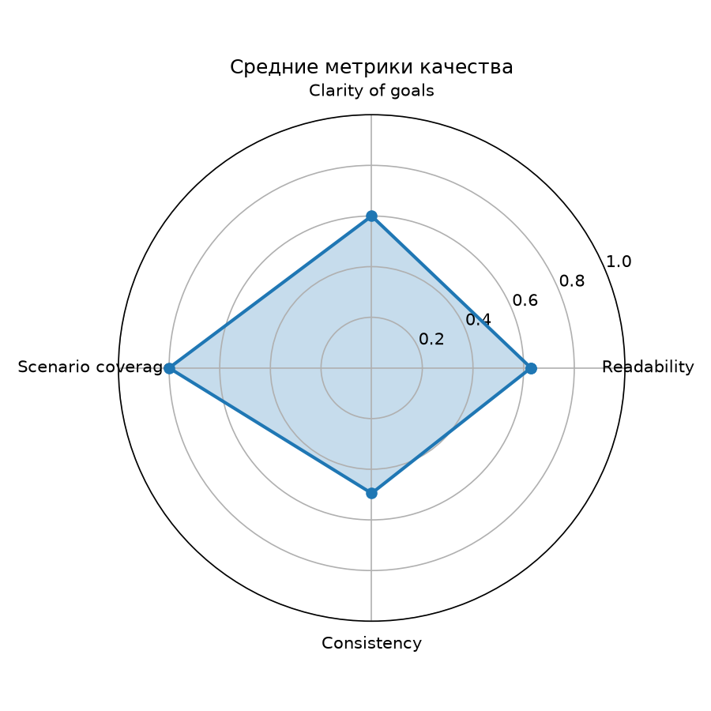
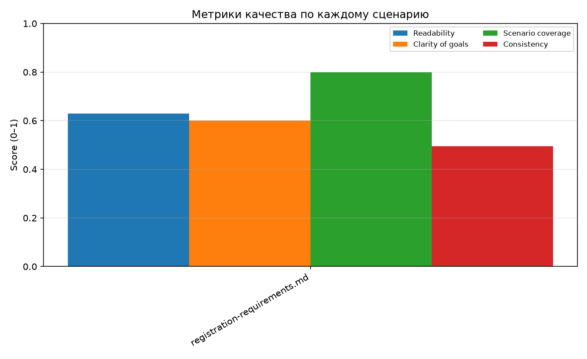

# Отчёт о качестве генерации тестовой документации

## Общая информация

| Параметр | Значение |
|---|---|
| Дата прогона | 2026-11-11T10:23:20+00:00 |
| Входная папка | `input` |
| Тип артефакта | `testcases` |
| Модель | `qwen2.5:7b-instruct` |
| Кейсов на файл | 4 |
| Повторов на сценарий | 2 |
| Нормализация требований | нет |
| Пресеты | — |
| Всего сценариев | 1 |
| Успешные (overall ≥ 0.5) | 1 |
| Неуспешные | 0 |

## Распределение качества

| Метрика | Среднее | Доля | Комментарий |
|---|---:|---:|---|
| Readability | 0.629 | 62.9% | средняя длина предложения, оптимум 17 слов |
| Clarity of goals | 0.600 | 60.0% | 5 категорий измеримых формулировок |
| Scenario coverage | 0.800 | 80.0% | доля BR-N из входа, упомянутых в результате |
| Consistency | 0.495 | 49.5% | Jaccard повторных генераций |
| Overall | 0.646 | 64.6% | взвешенное среднее известных метрик |

> `n/a` означает, что метрику нельзя измерить (например, в требованиях нет идентификаторов `BR-N`), а не нулевое качество.

## Список сценариев

| № | Файл | Overall | Readability | Clarity | Coverage | Consistency | Оценка |
|---:|---|---:|---:|---:|---:|---:|---|
| 1 | registration-requirements.md | 0.646 | 0.629 | 0.600 | 0.800 | 0.495 | успешный |

## Детализация по сценариям

### 1. registration-requirements.md

- Overall: **0.646**
- Readability: 0.629
- Clarity of goals: 0.600
- Scenario coverage: 0.800
- Consistency: 0.495
- Требования во входе: BR-1, BR-2, BR-3, BR-4, BR-5
- Покрытые требования: BR-1, BR-2, BR-3, BR-5
- Тест-кейсов: 4
- Попыток генерации: 1
- Повторов для consistency: 2
- SHA-256 промпта: `7058245ae191d02aab1187e5c477834ac29d7bda32f01e2566670ea4168e160a`
- Результат: output/live/scenarios/registration-requirements.md

| ID | Тип | Заголовок | Требование |
|---|---|---|---|
| TC-01 | positive | Открытие формы регистрации | BR-1 |
| TC-02 | positive | Успешная регистрация с корректными данными | BR-5 |
| TC-03 | negative | Некорректный email при регистрации | BR-2 |
| TC-04 | negative | Пароль не соответствует требованиям при регистрации | BR-3 |

## Визуальный отчёт

| График | Файл |
|---|---|
| Boxplot распределения метрик | `charts/metrics_boxplot.png` |
| Radar-chart средних метрик | `charts/radar_chart.png` |
| Оценки по сценариям | `charts/per_scenario_scores.png` |

## Источник данных

- JSON (источник правды): `quality-metrics.json`
- Markdown (представление): `report.md`
- Сгенерированные артефакты: `scenarios/*.md`
- Генерация: Ollama и вендоренные шаблоны промптов
- Нормализация требований: детерминированный нормализатор проекта
- Метрики: детерминированный анализ текста, без LLM-судьи
